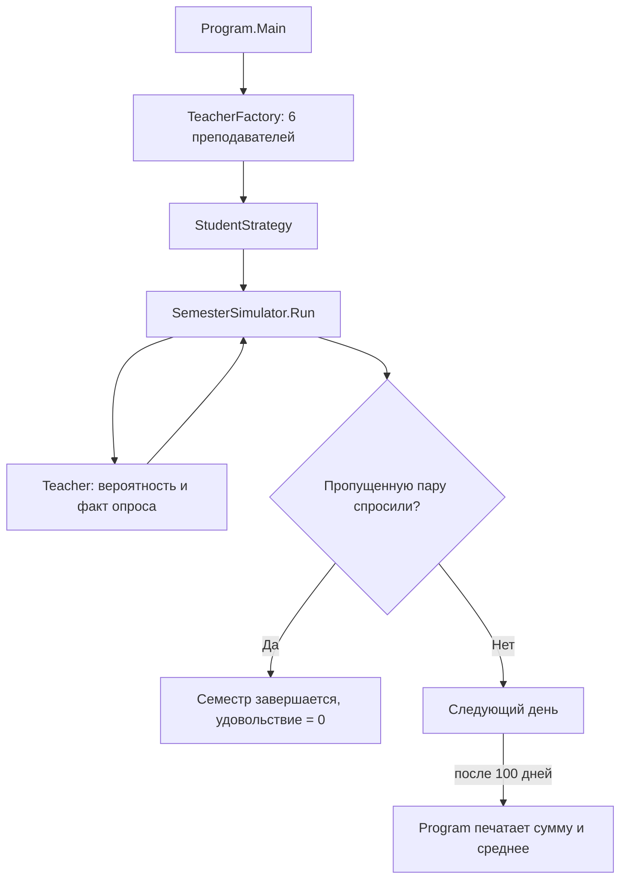

# «Мастер прогулов 80-го уровня»

Консольная программа моделирует один 100-дневный семестр. На каждом из шести предметов преподаватель может спросить студента по одному из трёх правил. Студент выбирает, какие пары пропустить; каждый пропуск и ежедневный пирожок дают по одному очку удовольствия. Если пропущенную пару спросили, студент вылетает, а удовольствие за семестр обнуляется.

Этот README описывает текущее состояние исходного кода и сопоставляет его с заданием из [`Csharp/req.txt`](Csharp/req.txt). В проекте есть заготовки для конкурса стратегий, однако текущий запуск пока не использует конкурсный интерфейс и историю.

## Структура репозитория

```text
.
├── Csharp.sln                 # Решение Visual Studio / Rider
├── .gitignore                 # Исключения для артефактов сборки и IDE
├── README.md                  # Этот обзор
└── Csharp/
    ├── Csharp.csproj          # Настройки консольного проекта (.NET 10)
    ├── Program.cs             # Точка входа: создаёт преподавателей и запускает семестр
    ├── Subject.cs              # Перечисление шести предметов
    ├── Teacher.cs              # Правила и вероятность опроса преподавателя
    ├── TeacherFactory.cs       # Случайно назначает преподавателям правила и зависимости
    ├── StudentStrategy.cs      # Текущая простая стратегия прогулов
    ├── SemesterSimulator.cs    # Проводит дни семестра, считает удовольствие и вылет
    ├── SemesterResult.cs       # Тип для результата семестра (пока не используется)
    ├── StrategyContracts.cs    # Публичные интерфейсы конкурсной стратегии и истории
    ├── StudentHistory.cs       # Реализация истории посещений и известных опросов
    ├── DayResult.cs            # Результат одного дня по всем предметам
    ├── LessonResult.cs         # Результат одной пары
    └── req.txt                 # Полный текст задания преподавателя
```

`Csharp/bin` и `Csharp/obj` создаются при сборке. Их содержимое не является исходным кодом и обычно не требуется сдавать: правила в `.gitignore` исключают эти каталоги из Git.

## Как проходит текущий запуск



1. `Program.Main` создаёт `Random`, через `TeacherFactory` случайно формирует шесть преподавателей и запускает `SemesterSimulator` с `StudentStrategy`.
2. В начале семестра массив `yesterdayAsked` заполнен значениями `false`. Поэтому в первый день считается, что накануне никого не спрашивали.
3. В начале каждого дня студент получает одно очко за пирожок. Затем для каждой пары стратегия решает, пропускать ли её.
4. `Teacher.WillAsk` определяет, будет ли опрос: никогда, всегда или с вероятностью 50% в зависимости от правила и результатов предыдущего дня.
5. Если студент прогулял и преподаватель спросил, `SemesterSimulator.Run` немедленно возвращает `0`. Иначе за пропуск добавляется ещё одно очко.
6. Факты сегодняшних опросов становятся входом для правил следующего дня. После 100 успешных дней программа печатает общее удовольствие и делит его на 100 для среднего за день.

### Подробно о логике одного дня

`SemesterSimulator.Run` хранит `yesterdayAsked` — шесть значений, по одному на каждый предмет. Индекс значения совпадает с числовым значением `Subject`: например, результат для `Calculus` лежит в позиции 0. На каждом новом дне создаётся такой же массив `todayAsked`.

Для каждой пары симулятор делает следующее:

1. Передаёт преподавателю вчерашние результаты через `StudentStrategy.ShouldSkip`, чтобы решить, пропускать ли пару.
2. Вызывает `Teacher.WillAsk`, чтобы определить, будет ли опрос сегодня. Вероятность вычисляется по вчерашним результатам, а для правила 50% используется случайное число.
3. Записывает факт опроса в `todayAsked`. Это делается даже для пропущенной пары, потому что результат моделирует преподавателя и будет влиять на его правила завтра. В конкурсном API студент не должен узнавать результат опроса пропущенной пары; текущая простая стратегия этого результата не читает.
4. Если пара пропущена, добавляет очко удовольствия. Если при этом был опрос, немедленно заканчивает семестр с результатом 0.

Когда все шесть пар завершены без вылета, `todayAsked` становится `yesterdayAsked`, и начинается следующий день. Пирожок начисляется перед обработкой занятий, так что пирожок тоже обнуляется при вылете: итоговый результат за такой семестр именно 0.

### Как читаются правила преподавателя

Каждый `Teacher` связан с одним предметом и хранит тип правила, а также `DependA` и `DependB` для зависимых правил. Правило применяется к результатам опросов по предметам за предыдущий день, а не к тому, был ли студент на паре.

| Правило в коде | Когда преподаватель спрашивает |
|---|---|
| `Check50` | С вероятностью 50%, независимо от вчерашнего дня. |
| `DependA` | Если вчера спрашивали по предмету A; иначе не спрашивает. |
| `XorAandB` | Если вчера спрашивали ровно по одному из предметов A и B; если спрашивали по обоим или ни по одному — не спрашивает. |

`Teacher.GetAskProbability` возвращает вероятность как `0.0`, `0.5` или `1.0`. `Teacher.WillAsk` преобразует её в исход: при 0 всегда `false`, при 1 всегда `true`, при 0.5 — случайный исход. Предмет A может совпасть с предметом преподавателя; A и B между собой совпасть не могут.

### Что именно считает стратегия

Текущая `StudentStrategy` получает преподавателя и вчерашние исходы. Она проверяет вероятность вызова через `GetAskProbability`:

- вероятность `0.0` → прогулять;
- вероятность `0.5` или `1.0` → присутствовать.

Следовательно, при текущей стратегии вылет не должен происходить: студент прогуливает только тогда, когда `WillAsk` гарантированно вернёт `false`. Это простая консервативная эвристика, а не поиск оптимальной стратегии. Она также принимает решение по каждой паре отдельно, тогда как конкурсный контракт требует выдать массив решений на весь день.

## Файлы и их роли

| Файл | Назначение | Связи с другими файлами |
|---|---|---|
| `Csharp/Program.cs` | Точка входа. Создаёт генератор случайных чисел, преподавателей, стратегию и симулятор; печатает итог. | Вызывает `TeacherFactory`, `StudentStrategy`, `SemesterSimulator`. |
| `Csharp/Subject.cs` | `enum Subject` с шестью предметами. Порядок значений также используется для индексации массива вчерашних опросов. | Используется в `Teacher`, `TeacherFactory`, `DayResult`, `StudentHistory`, контракте истории. |
| `Csharp/Teacher.cs` | `TeacherRule` задаёт одно из трёх правил. `GetAskProbability` возвращает 0, 0.5 или 1, а `WillAsk` разыгрывает фактический результат. | Создаётся `TeacherFactory`; вызывается симулятором; использует `Subject`. |
| `Csharp/TeacherFactory.cs` | Создаёт по одному преподавателю на предмет. Случайно выбирает правило и предметы A и B; A и B различны, каждый может совпасть с предметом самого преподавателя. | Вызывается `Program`; создаёт объекты `Teacher`. |
| `Csharp/StudentStrategy.cs` | Текущая стратегия: пропускать пару только при нулевой вероятности опроса. | Вызывается `SemesterSimulator`; обращается к вероятности через `Teacher.GetAskProbability`. Не реализует `ISkipStrategy`. |
| `Csharp/SemesterSimulator.cs` | Игровой цикл на 100 дней; учитывает пирожок, прогул, опрос и вылет. | Получает преподавателей и стратегию из `Program`; вызывает методы преподавателя и студента. |
| `Csharp/SemesterResult.cs` | Запись с полями `Pleasure` и `Expelled` для результата семестра. | Сейчас нигде не используется: симулятор возвращает только `int`. |
| `Csharp/StrategyContracts.cs` | Публичные `ISkipStrategy` и `IReadOnlyStudentHistory` — заявленный API для конкурсных стратегий. `DecideDay` должен вернуть решение по всем предметам сразу. | Предполагается использовать в общем раннере конкурса; текущие `Program` и `SemesterSimulator` пока их не вызывают. |
| `Csharp/StudentHistory.cs` | Хранит `DayResult` по дням и реализует чтение посещения и известности опроса. Для пропущенной пары `WasAsked` возвращает `null`. | Реализует `IReadOnlyStudentHistory`; использует `DayResult` и `LessonResult`. Сейчас не подключён к симулятору. |
| `Csharp/DayResult.cs` | Контейнер результатов всех занятий одного дня, индексируемый по предмету. Проверка полноты дня выполняется при добавлении в историю. | Использует `LessonResult`; предназначен для `StudentHistory`. Сейчас симулятор его не создаёт. |
| `Csharp/LessonResult.cs` | Хранит факт посещения и фактический факт опроса по одной паре. | Используется `DayResult` и `StudentHistory`; не подключён к текущему циклу моделирования. |
| `Csharp/Csharp.csproj` | Настраивает исполняемый проект, `net10.0`, implicit usings и nullable-аннотации. NuGet-зависимости не объявлены. | Включает исходники каталога в сборку .NET. |
| `Csharp.sln` | Решение, содержащее проект `Csharp/Csharp.csproj` и конфигурации Debug/Release. | Открывается в Visual Studio или Rider. |
| `.gitignore` | Исключает `bin`, `obj`, NuGet packages и кэш Rider/ReSharper. | Не влияет на выполнение, только на Git. |
| `Csharp/req.txt` | Требования и правила лабораторной/конкурса. | Источник для таблицы соответствия ниже. |

## Сопоставление с требованиями

| Требование из `req.txt` | Что есть сейчас | Оценка |
|---|---|---|
| Консольное приложение | `Csharp.csproj` имеет `OutputType` `Exe`; `Program.Main` выводит результат. | Выполнено. |
| Шесть заданных предметов | В `Csharp/Subject.cs` перечислены шесть предметов. | Выполнено. |
| Семестр в 100 учебных дней | Цикл в `SemesterSimulator.Run` выполняется для дней `0..99`. | Выполнено. |
| Три правила преподавателей | `Teacher.GetAskProbability` обрабатывает случай 50%, зависимость от A и XOR-условие для A/B. | Выполнено. |
| Случайный выбор правила и A/B на старте | `TeacherFactory.CreateTeachers` создаёт весь набор один раз перед запуском семестра; A и B выбираются разными. | Выполнено. |
| В первый день накануне не было опросов | `yesterdayAsked` изначально заполнен `false`. | Выполнено. |
| Пирожок каждый день и удовольствие от пропусков | Симулятор добавляет одно очко в начале дня и одно за каждый пропуск. | Выполнено. |
| При пропуске и опросе вылететь и обнулить накопленное удовольствие | При таком исходе симулятор сразу возвращает `0`. | Поведение реализовано; результат не помечается отдельным флагом вылета. |
| Напечатать общее удовольствие и среднее за день | `Program` выводит сумму и сумму / 100. | Выполнено для одного прогона. При вылете печатается 0 и среднее 0. |
| Конкурс: `ISkipStrategy`, имя, решение на день и чтение истории | Контракты и отдельные типы истории есть, но текущая стратегия не реализует интерфейс, симулятор не передаёт историю и запрашивает решения не через `DecideDay`. | Частично: заготовка контракта есть, конкурсный запуск не подключён. |
| Средний результат по 1000 итерациям | `Program` запускает только один семестр. | Не реализовано. |
| Отдельный сдаваемый проект стратегии на .NET 10 без сторонних пакетов | Основной проект — .NET 10 и без объявленных внешних пакетов; отдельного проекта стратегии нет. | Требование конкурса ещё не реализовано/не является частью этого проекта. |

## Текущая стратегия

`StudentStrategy.ShouldSkip` пропускает пару только если вычисленная вероятность опроса равна `0`. При вероятности `0.5` или `1` студент идёт на занятие. Это безопасная локальная эвристика: она не рискует вылететь на паре, которую преподаватель точно спросит, и не использует `IReadOnlyStudentHistory`.

## Как объяснить проект на защите

Краткий рассказ можно построить так:

> Программа моделирует один семестр из 100 дней и шесть предметов. В начале прогона случайно создаются преподаватели: каждому назначается одно из трёх правил опроса и, где нужно, предметы-зависимости A и B. В начале дня студент выбирает, какие пары посетить. Текущая стратегия прогуливает только те пары, где вероятность опроса равна нулю. После этого симулятор разыгрывает опросы, добавляет удовольствие за пирожок и прогул, а результаты опросов использует для правил на следующий день. Если студент прогулял и его спросили, семестр заканчивается с нулевым удовольствием. В конце программа выводит удовольствие и среднее за день.

Если преподаватель спросит, почему в коде есть `StudentHistory`, `DayResult` и `LessonResult`, ответ: это основа для конкурсного API. Она хранит прошедшие дни и скрывает от стратегии исход опроса пропущенной пары через `null`. В нынешнем запуске эти типы пока не подключены к `SemesterSimulator`.

Если спросят, оптимальна ли стратегия, ответ: нет, это базовая безопасная стратегия для демонстрации механики. Для максимизации среднего результата нужна стратегия, сравнивающая награду за прогул с накопленным риском вылета, и её следует оценивать на множестве случайных семестров.

## Важные замечания перед сдачей

- В `Program.cs` объявлено ещё одно глобальное перечисление `Subject` со значениями `Math` и `LinearAlg`. Оно не используется; основное перечисление — `Csharp.Subject` из `Subject.cs`, где имена соответствуют конкурсному контракту (`Calculus`, `LinearAlgebra` и т. д.). Два перечисления с одинаковым именем могут запутать читателя, поэтому неиспользуемое объявление лучше удалить.
- Текущая программа делает один прогон, а не среднее по 1000 итерациям. Если сдаётся только лабораторная №1, один прогон соответствует её формулировке. Если требуется сдача конкурсного решения, этого проекта недостаточно.
- `StudentStrategy` не реализует `ISkipStrategy`; методы `DecideDay` и `Name` сейчас фактически не задействованы. Аналогично, `StudentHistory`, `DayResult`, `LessonResult` и `SemesterResult` — незадействованные заготовки, а не часть реального пути выполнения.
- Симулятор возвращает только целое число удовольствия. Он не различает в возвращаемом значении успешное завершение и вылет; `SemesterResult` мог бы хранить это отдельно, но пока не используется.
- Результат случайный: меняются и набор преподавателей, и исходы 50-процентных опросов. В программе нет seed-параметра или серии прогонов для усреднения.

## Запуск

Из корневого каталога репозитория:

```powershell
dotnet run --project .\Csharp\Csharp.csproj
```

Каждый запуск случайно создаёт преподавателей и случайные исходы для правил с вероятностью 50%, поэтому итог может отличаться. `Random` создаётся без фиксированного seed; воспроизводимость конкретного прогона не гарантируется.

## Что потребуется для полного конкурсного режима

Чтобы текущий код соответствовал конкурсной части `req.txt`, потребуется связать контракт и симулятор: передавать стратегии `IReadOnlyStudentHistory`, запрашивать `DecideDay` один раз за день, сохранять результаты посещения и известные студенту исходы в `StudentHistory`, а также добавить внешний прогон 1000 семестров и усреднение. Это перечисление описывает разрыв между заданием и нынешней реализацией, а не утверждает, что эти функции уже присутствуют.
