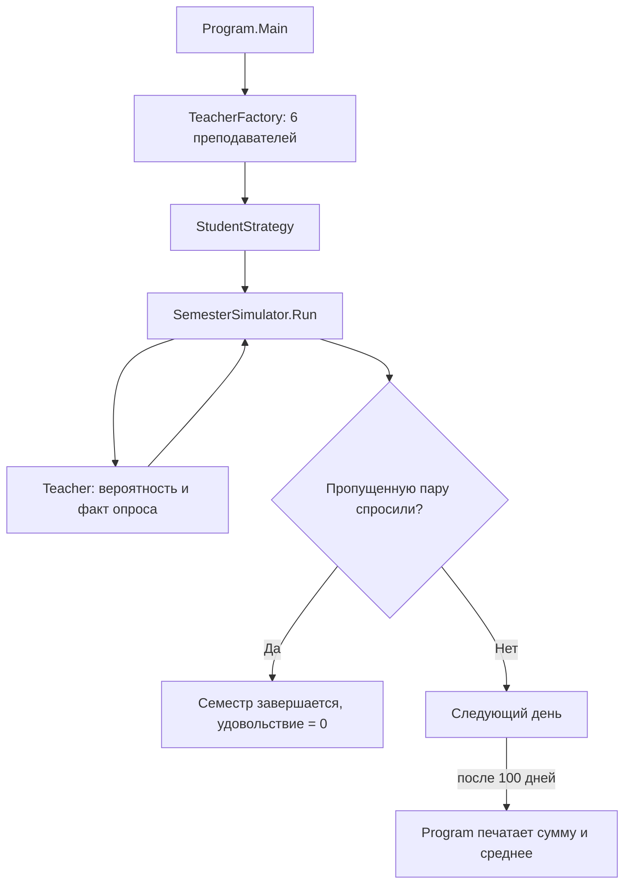

# «Мастер прогулов 80-го уровня»

Актуальное дополнение ЛР №4: PostgreSQL, запуск нового семестра и продолжение
по UUID описаны в [учебных заметках](docs/LAB4_POSTGRES_STUDY_NOTES.md).
Новые режимы: `--new-semester`, `--resume-semester <UUID>`, `--list-semesters`.
Ниже сохранён исходный обзор ЛР №1; он не описывает все последующие изменения.

Консольная программа моделирует один 100-дневный семестр. На каждом из шести предметов преподаватель может спросить студента по одному из трёх правил. Студент выбирает, какие пары пропустить; каждый пропуск и ежедневный пирожок дают по одному очку удовольствия. Если пропущенную пару спросили, студент вылетает, а удовольствие за семестр обнуляется.

Этот README описывает текущее состояние исходного кода и сопоставляет его с заданием из [`Csharp/req.txt`](Csharp/req.txt). В проекте есть заготовки для конкурса стратегий, однако текущий запуск пока не использует конкурсный интерфейс и историю.

## Структура репозитория

```text
.
├── Csharp.sln                 # Решение Visual Studio / Rider
├── .gitignore                 # Исключения для артефактов сборки и IDE
├── README.md                  # Этот обзор
└── Csharp/
    ├── Csharp.csproj          # Настройки консольного проекта (.NET 10)
    ├── Program.cs             # Точка входа: создаёт преподавателей и запускает семестр
    ├── Subject.cs              # Перечисление шести предметов
    ├── Teacher.cs              # Правила и вероятность опроса преподавателя
    ├── TeacherFactory.cs       # Случайно назначает преподавателям правила и зависимости
    ├── StudentStrategy.cs      # Текущая простая стратегия прогулов
    ├── SemesterSimulator.cs    # Проводит дни семестра, считает удовольствие и вылет
    ├── SemesterResult.cs       # Тип для результата семестра (пока не используется)
    ├── StrategyContracts.cs    # Публичные интерфейсы конкурсной стратегии и истории
    ├── StudentHistory.cs       # Реализация истории посещений и известных опросов
    ├── DayResult.cs            # Результат одного дня по всем предметам
    ├── LessonResult.cs         # Результат одной пары
    └── req.txt                 # Полный текст задания преподавателя
```

`Csharp/bin` и `Csharp/obj` создаются при сборке. Их содержимое не является исходным кодом и обычно не требуется сдавать: правила в `.gitignore` исключают эти каталоги из Git.

## Как проходит текущий запуск



Для каждой пары симулятор делает следующее:

1. Передаёт преподавателю вчерашние результаты через `StudentStrategy.ShouldSkip`, чтобы решить, пропускать ли пару.
2. Вызывает `Teacher.WillAsk`, чтобы определить, будет ли опрос сегодня. Вероятность вычисляется по вчерашним результатам, а для правила 50% используется случайное число.
3. Записывает факт опроса в `todayAsked`. Это делается даже для пропущенной пары, потому что результат моделирует преподавателя и будет влиять на его правила завтра. В конкурсном API студент не должен узнавать результат опроса пропущенной пары; текущая простая стратегия этого результата не читает.
4. Если пара пропущена, добавляет очко удовольствия. Если при этом был опрос, немедленно заканчивает семестр с результатом 0.

Когда все шесть пар завершены без вылета, `todayAsked` становится `yesterdayAsked`, и начинается следующий день. Пирожок начисляется перед обработкой занятий, так что пирожок тоже обнуляется при вылете: итоговый результат за такой семестр именно 0.

### Как читаются правила преподавателя

Каждый `Teacher` связан с одним предметом и хранит тип правила, а также `DependA` и `DependB` для зависимых правил. Правило применяется к результатам опросов по предметам за предыдущий день, а не к тому, был ли студент на паре.

| Правило в коде | Когда преподаватель спрашивает |
|---|---|
| `Check50` | С вероятностью 50%, независимо от вчерашнего дня. |
| `DependA` | Если вчера спрашивали по предмету A; иначе не спрашивает. |
| `XorAandB` | Если вчера спрашивали ровно по одному из предметов A и B; если спрашивали по обоим или ни по одному — не спрашивает. |

`Teacher.GetAskProbability` возвращает вероятность как `0.0`, `0.5` или `1.0`. `Teacher.WillAsk` преобразует её в исход: при 0 всегда `false`, при 1 всегда `true`, при 0.5 — случайный исход. Предмет A может совпасть с предметом преподавателя; A и B между собой совпасть не могут.

### Что именно считает стратегия

Текущая `StudentStrategy` получает преподавателя и вчерашние исходы. Она проверяет вероятность вызова через `GetAskProbability`:

- вероятность `0.0` → прогулять;
- вероятность `0.5` или `1.0` → присутствовать.

Следовательно, при текущей стратегии вылет не должен происходить: студент прогуливает только тогда, когда `WillAsk` гарантированно вернёт `false`. Это простая консервативная эвристика, а не поиск оптимальной стратегии. Она также принимает решение по каждой паре отдельно, тогда как конкурсный контракт требует выдать массив решений на весь день.


## Текущая стратегия

`StudentStrategy.ShouldSkip` пропускает пару только если вычисленная вероятность опроса равна `0`. При вероятности `0.5` или `1` студент идёт на занятие. Это безопасная локальная эвристика: она не рискует вылететь на паре, которую преподаватель точно спросит, и не использует `IReadOnlyStudentHistory`.

## Запуск

Из корневого каталога репозитория:

```powershell
dotnet run --project .\Csharp\Csharp.csproj
```

